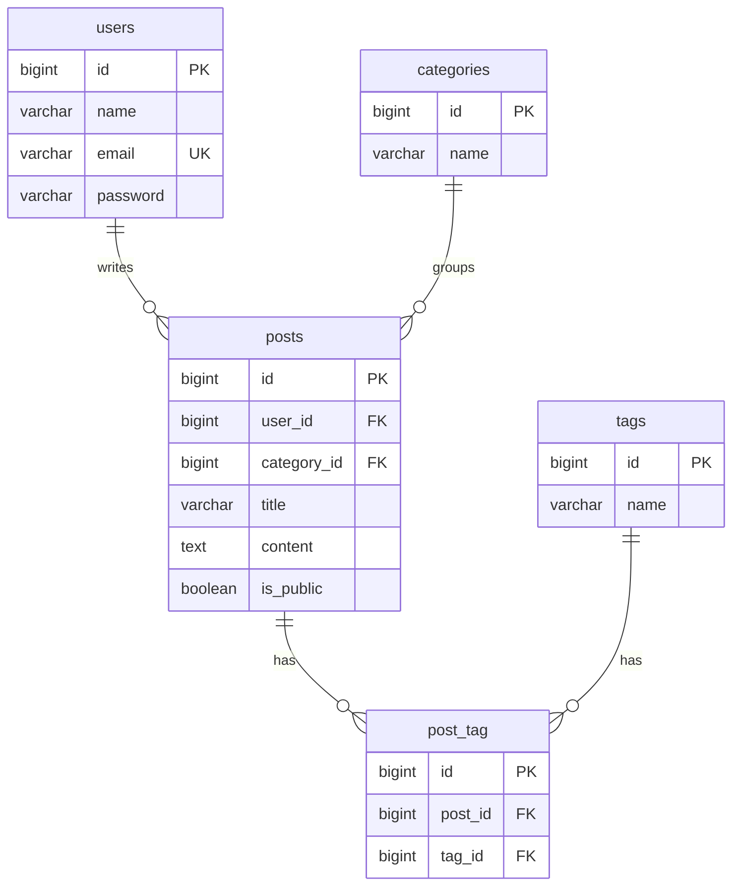

# Little Robot Lab

A robotics blog for parents building projects with their kids. Authors can create, publish, edit and delete their own posts. Visitors can browse public posts by category and author.

## Database schema

## Relationships

- A user can write many posts. Each post belongs to one user.
- A category can contain many posts. Each post belongs to one category.
- Posts and tags have a many-to-many relationship through the post_tag table.

PK means primary key. FK means foreign key. UK means unique key.

The users, posts, categories and tags tables also have created_at and updated_at timestamps. The post_tag table has a unique post_id and tag_id pair, so the same tag cannot be added to a post twice.
