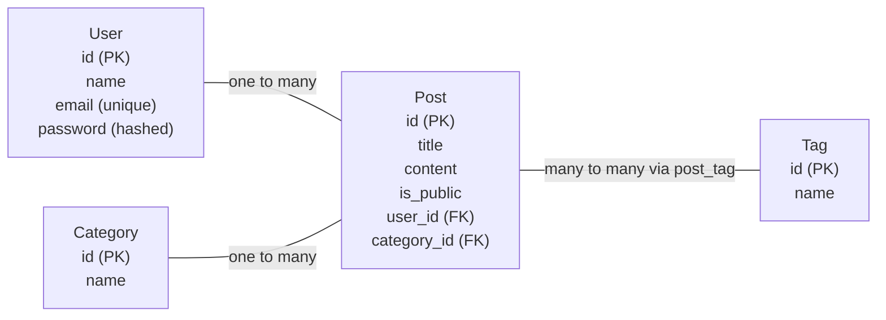

# Little Robot Lab

A robotics blog for parents building projects with their kids. Authors can create, publish, edit and delete their own posts. Visitors can browse public posts by category and author.

## Database schema

## Relationships

- A user can write many posts. Each post belongs to one user.
- A category can contain many posts. Each post belongs to one category.
- A post can have many tags, and a tag can belong to many posts.

PK means primary key. FK means foreign key.

The post_tag linking table stores id, post_id and tag_id. Each row connects one post to one tag. A unique post_id and tag_id pair prevents adding the same tag to a post twice.

The User, Post, Category and Tag tables also have created_at and updated_at timestamps.
